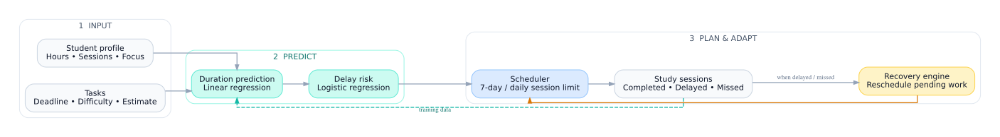
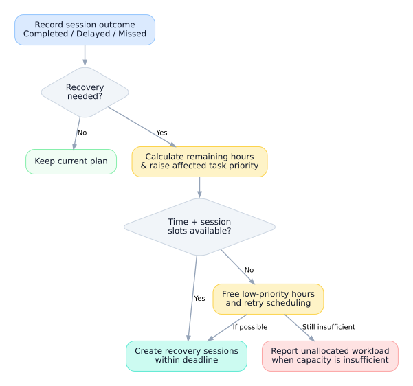

# RecoverPlan

**Adaptive study scheduling with C++ and machine learning**  
**University course project · Team project · MVP**

We built RecoverPlan as a **required university project** during our Computer Engineering studies. The idea was to make study planning a little more realistic: instead of writing a fixed timetable and hoping everything goes as planned, we wanted to estimate how long tasks might take and adjust the schedule when someone falls behind.

We worked on this as a team. **I was responsible for the time-prediction and delay-prediction models, and I worked on the final integration.** The rest of the application was split between task management, student profiles, scheduling, recovery, and reports.

The result is a **working command-line MVP in C++17**. It isn't a finished product, and the prediction models still need proper evaluation with more data.



## What it can do

- Add study tasks manually or import them from a CSV file.
- Set daily study hours and the number of study sessions per day.
- Estimate task duration using a linear regression model.
- Estimate the risk of missing a deadline using logistic regression.
- Build a seven-day schedule using priorities such as deadline, importance, or difficulty.
- Record completed, delayed, and missed study sessions.
- Try to reschedule unfinished work when a session is missed.
- Save and reload student information, tasks, and previous sessions.

## My work on the ML part

I implemented the prediction models in C++ instead of relying on a machine learning library. I wanted to work directly with the equations, training loop, and features rather than treating a model as a black box.

### Time prediction

The linear regression model uses seven inputs: task difficulty, importance, the student's estimated time, pages or questions, task type, focus score, and completion rate.

```text
predicted_hours = w · x + b
```

I used batch gradient descent to update the weights. Until the application has at least three completed-session examples, it falls back to the student's own time estimate rather than showing an untrained prediction.

### Delay prediction

The logistic regression model uses eight inputs, including predicted task duration, time left until the deadline, available study hours, previous missed sessions, and student-related features.

```text
p(delay | x) = 1 / (1 + exp(-(w · x + b)))
```

The model is trained using labeled session results and the binary cross-entropy gradient. It only displays a delay-risk prediction after at least three labeled examples. We use simple low/medium/high thresholds for the MVP; these aren't calibrated or validated probabilities yet.


## Scheduling and recovery

After entering tasks and study availability, the scheduler builds a plan for up to seven days. It can order tasks by deadline, importance, difficulty, shortest duration, or predicted delay risk (once that model has training data).

When a session is missed or delayed, the recovery engine tries to fit the unfinished work into the remaining available sessions before the deadline. If the available time isn't enough, the application reports the remaining work instead of pretending everything fits.



## How to run it

**Requirements:** C++17 and CMake 3.16+. No external C++ libraries are needed.

```bash
cmake -S . -B build
cmake --build build
./build/recoverplan
```

On Windows with a multi-configuration generator, the executable may be at `build/Debug/recoverplan.exe`.

To try the main flow:

1. Choose **1 – Set student info** and enter your available study hours, sessions per day, and focus score.
2. Choose **4 – Import tasks from CSV** and use `data/sample_tasks.csv` (or add tasks with option **3**).
3. Choose **8 – Build schedule**, then **10 – Show schedule**.
4. Choose **11 – Record session results** and mark a session missed or delayed.
5. Choose **12 – Run recovery plan** to see the updated schedule.

The application saves its local state to `recoverplan_save.dat` (not tracked by Git). Older save files are supported; if they don't contain the daily session count, the app defaults to one session per day.

## Tests

```bash
cmake -S . -B build
cmake --build build
ctest --test-dir build --output-on-failure
```

The included smoke test covers CSV import, scheduling limits, saving and loading, missed-session recovery, and compatibility with older saves.

## Project structure

```text
include/                C++ headers
src/                    Application and ML implementation
data/sample_tasks.csv   Sample tasks for a demo
docs/assets/            Diagrams and illustrations
docs/diagrams/          Editable diagram sources
docs/MODEL_NOTES.md     Model details and limitations
tests/smoke_test.py     End-to-end CLI test
CMakeLists.txt          Build configuration
```

## What still needs improvement

This is a university MVP, so there are things we haven't finished yet:

- **Model evaluation:** we haven't included a held-out dataset or a comparison with baseline models. The sigmoid plot is just an explanation of the function, not an accuracy result.
- **Training data:** three examples are enough to demonstrate the training flow, but nowhere near enough to prove reliable predictions.
- **Modeling:** feature scaling, regularization, and better data-quality checks are still future work.
- **Scheduling:** the current planning window is limited to seven days.
- **Interface:** it's a local command-line application; there's no web or mobile version.

More implementation details are in [MODEL_NOTES.md](docs/MODEL_NOTES.md).

## Team

We divided the work as follows:

| Part | Team member |
| --- | --- |
| Task management and reporting | Omar Al-Tasha |
| Student profile and study sessions | Ali Al-Or |
| Time and delay prediction models | Mulham Sadeh |
| Scheduling and recovery engine | Mohammad Ramez Hamdo |
| Final integration | Mulham Sadeh |

RecoverPlan started as a **university requirement**, but it also gave me a chance to practice implementing regression models from scratch and connecting them to a real application workflow.
