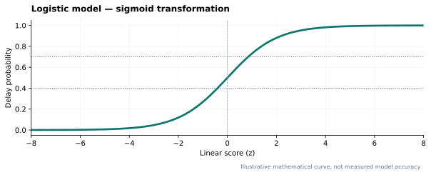

# RecoverPlan

**An adaptive study planner with predictive modeling — a C++17 academic MVP.**

RecoverPlan helps a student turn a set of deadlines into a seven-day study schedule. Instead of using only fixed estimates, it can learn from recorded study sessions to estimate task duration and delay risk, and then reorganize work after sessions are missed or delayed.

> **Project status:** Working command-line MVP, not a production application. Prediction models require recorded training examples; the app uses student-entered duration estimates until enough examples are available.


## What the MVP does

- **Manage tasks:** add tasks manually or import them from CSV; capture subject, type, difficulty, importance, estimated hours, work size, and deadline.
- **Set realistic study capacity:** configure available hours **and number of sessions per day**. The planner splits tasks into sessions instead of a single long daily block.
- **Predict study time:** multivariate linear regression implemented from scratch with batch gradient descent.
- **Estimate delay risk:** logistic regression with a sigmoid output, using predicted duration and student/task context.
- **Schedule:** use one of five ordering strategies — nearest deadline, highest importance, highest difficulty, shortest task, or highest delay risk (when available).
- **Recover from setbacks:** record completed, delayed, or missed sessions; attempt to reschedule unfinished hours before deadlines, and report capacity limits.
- **Keep your work:** save and reload student data, tasks, schedules, and training examples from a local text file.

## Quick start

Requires **C++17** and **CMake 3.16+**. No third-party C++ libraries are required.

```bash
cmake -S . -B build
cmake --build build
./build/recoverplan
```

On Windows with a multi-configuration generator, launch `build/Debug/recoverplan.exe` instead.

For a quick demo:

1. Select **1 – Set student info** and enter a name, study hours/day, sessions/day, and focus score.
2. Select **4 – Import tasks from CSV** and enter `data/sample_tasks.csv`, or add a task with option **3**.
3. Select **8 – Build schedule** and choose a priority strategy; view it with **10 – Show schedule**.
4. Select **11 – Record session results** and mark one session *missed* or *delayed*.
5. Select **12 – Run recovery plan** and view the adjusted schedule with **10**.

The local session state is saved to `recoverplan_save.dat` (excluded from Git). It is automatically loaded on the next run. Saves from the original five-field student format are supported; they default to **one study session/day**.

## How it works

### 1. Predict task duration

The time predictor takes seven features:

`difficulty`, `importance`, `student-estimated hours`, `pages/questions`, `task-type weight`, `focus score`, and `completion rate`.

It estimates duration using linear regression:

```text
predicted_hours = w · x + b
```

Weights are learned through **batch gradient descent** from previously recorded session outcomes. Before **three completed-session examples** have been collected, the planner uses the student's estimated hours rather than presenting an untrained prediction.

### 2. Estimate delay probability

The delay model uses eight features: predicted duration, difficulty, importance, days remaining, available study hours/day, missed-session count, completion rate, and focus score. A sigmoid maps its linear score into a 0–1 value:

```text
p(delay | x) = 1 / (1 + exp(-(w · x + b)))
```

The training update corresponds to the gradient of logistic **binary cross-entropy**. Delay risk is shown as **N/A** until at least **three labeled session results** are recorded. Risk bands used by the report are *Low* (`p < 0.40`), *Medium* (`0.40 ≤ p < 0.70`), and *High* (`p ≥ 0.70`). These are application thresholds, **not validated risk calibration**.



### 3. Schedule, observe, recover

The scheduler plans at most seven days, respecting available hours, the configured number of daily sessions, and each task's deadline. When a session is missed or delayed, the recovery engine estimates remaining work, raises the affected task's priority, and tries to place recovery sessions before the deadline. If capacity is tight, it can free lower-priority scheduled hours and report remaining work.


## Project structure

```text
RecoverPlan/
├── include/                # C++ headers for the domain and ML modules
├── src/                    # C++ implementation + CLI application
├── data/sample_tasks.csv   # Importable demonstration tasks
├── docs/
│   ├── assets/             # Rendered diagrams and sigmoid illustration
│   ├── diagrams/           # Editable Graphviz (.dot) diagram sources
│   └── MODEL_NOTES.md      # Architecture, feature definitions, limitations
├── tests/smoke_test.py     # End-to-end CLI regression test
├── CMakeLists.txt
└── README.md
```

## Verify the MVP

```bash
cmake -S . -B build
cmake --build build
ctest --test-dir build --output-on-failure
```

The smoke test covers CSV import, session-count and duration limits, save/reload, missed-session recovery, and backward compatibility with older saves.

## Limitations and next steps

- **Not a validated forecasting system yet:** no independent evaluation dataset, held-out accuracy report, or benchmark comparison is included. The sigmoid chart explains the mathematical transformation, **not** measured predictive performance.
- **Small training datasets:** the three-example threshold enables training for demonstration purposes, but does not establish statistical reliability. Feature scaling, regularization, evaluation, and data-quality controls are future work.
- **Fixed scheduling horizon:** the current planner uses a seven-day window; deadlines beyond that horizon are capped for scheduling.
- **Local CLI:** no web/mobile interface, user accounts, hosted database, or deployment is included.
- **Session data:** training examples are derived from user-entered outcomes, not from a pre-trained external model.

See [technical notes](docs/MODEL_NOTES.md) for the current model inputs and implementation details.

## Academic team and contributions

RecoverPlan was developed as a **team academic project**. Responsibilities below are preserved from the original project documentation:

| Area | Contributor |
| --- | --- |
| Task management and reports | Omar Al-Tasha |
| Student profile and study sessions | Ali Al-Or |
| Time prediction and delay prediction models | Mulham Sadeh |
| Scheduling and recovery | Mohammad Ramez Hamdo |
| Final integration | Mulham Sadeh |

> The original Arabic presentation supplied with the project documents its intended design. This README distinguishes **implemented MVP behavior** from unvalidated performance claims.
